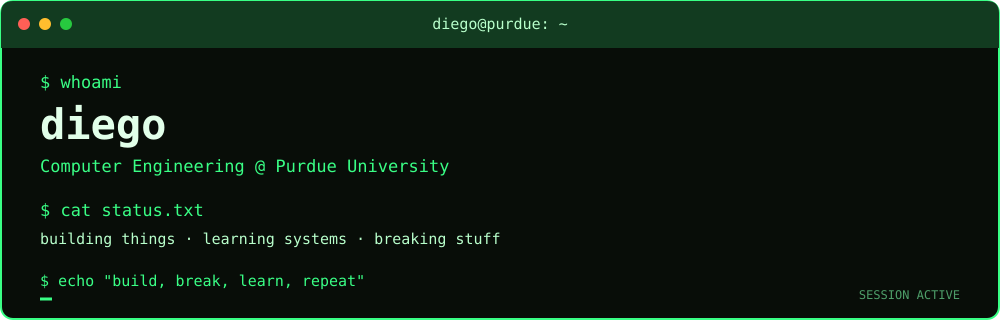

# hey, i'm diego 👾

**Computer Engineering @ Purdue University**

> professional hello world engineer.

I like figuring out how things work by building them, breaking them, and occasionally wondering why they worked in the first place.

I'm interested in software, systems, cybersecurity, and pretty much anything that lets me get closer to the metal. I like exploring unfamiliar technologies, experimenting with ideas, and building things just to see if I can.

### `what i'm into`

- Software development, backend engineering & APIs
- Cybersecurity, networking & understanding how systems break
- Systems programming, operating systems & computer architecture
- Databases, distributed systems & infrastructure
- Quantitative finance (software development), markets & mathematical modeling
- Side projects, weird experiments & technical rabbit holes

### `languages & tools`

**Languages:** Python · C · C++ · Java · Rust · JavaScript · TypeScript · Perl · SQL · Bash · SystemVerilog

**Web & backend:** React · JSX · Node.js · FastAPI · HTML/CSS · REST APIs · GraphQL

**Data:** PostgreSQL · MySQL · NoSQL · JSON · XML

**Tools & systems:** Linux · Git · GitHub · Make · HTTP · Networking

*Always learning something new. Definitely not claiming to have mastered everything.*

### `what i'm building`

I like projects that teach me something new, whether that's understanding how a system works under the hood or turning a random idea into working software.

- **Systems & low-level programming** — exploring memory, processes, networking, and how software interacts with hardware.
- **Cybersecurity** — learning security fundamentals, experimenting in authorized labs, and understanding vulnerabilities.
- **Software & infrastructure** — building APIs, working with databases, and connecting different systems.
- **Quant & data projects** — experimenting with market data, backtesting strategies, and using code and statistics to explore financial ideas.

### `what's next?`

- Exploring quantitative finance, algorithmic trading & strategy backtesting
- Getting deeper into probability, statistics, and mathematical modeling
- Learning more about cybersecurity, networking, and systems internals
- Building more systems-level projects with Rust and C/C++
- Experimenting with new languages, tools, and ideas that catch my attention

### `philosophy`

Learn by building. Understand by breaking. Repeat.

---

*If it can be coded, automated, reverse-engineered, or built from scratch, I probably want to try it.*

